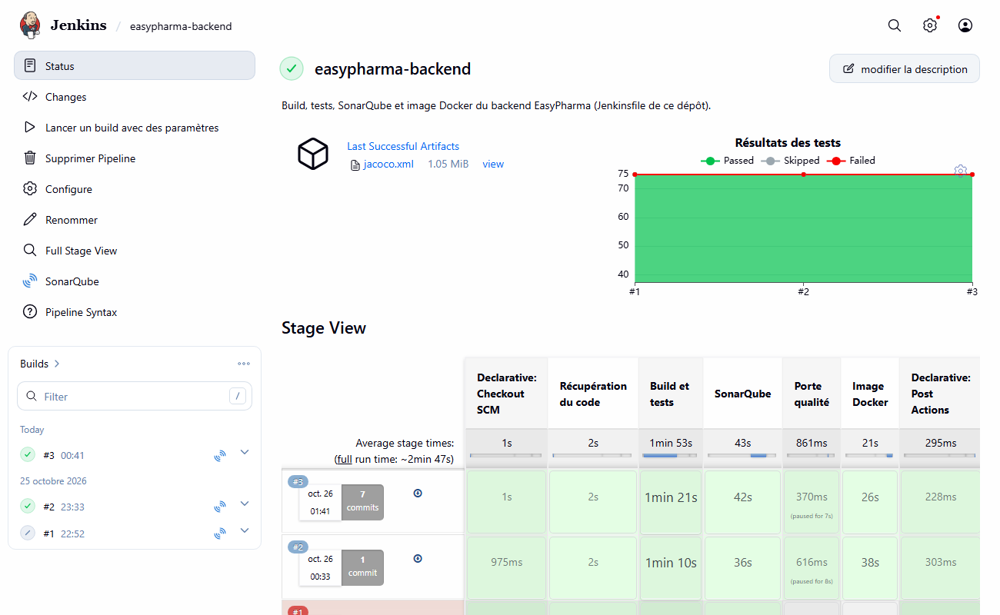
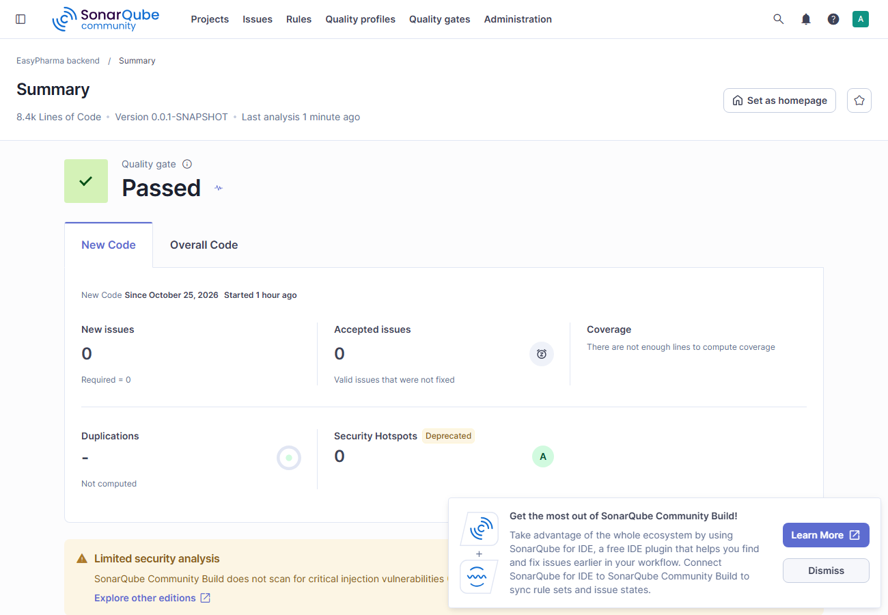
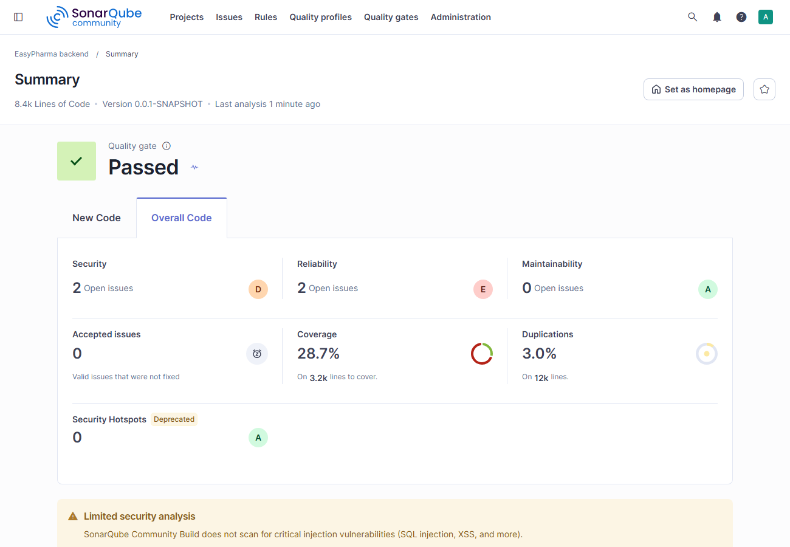
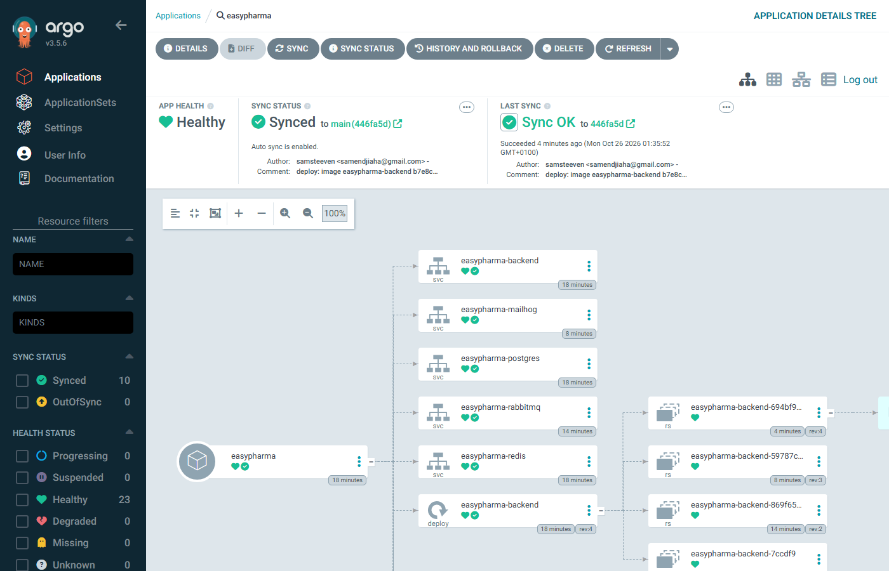

# Laboratoire CI/CD autour d'EasyPharma

[](https://github.com/samsteeven/easypharma-cicd-lab/actions/workflows/pipeline.yml)

Le même pipeline (build et 75 tests, analyse SonarQube avec porte qualité, image Docker) écrit **trois fois** : pour **Jenkins** (`Jenkinsfile` déclaratif et bibliothèque partagée Groovy), pour **GitLab CI** et pour **GitHub Actions**, puis déployé sur un cluster **Kubernetes local (kind)** avec un **chart Helm** synchronisé par **ArgoCD**.

L'application est le backend Spring Boot de [`easypharma-backend-lab`](https://github.com/samsteeven/easypharma-backend-lab) : ce dépôt ne la modifie pas, il la clone. Il ne contient que la définition des pipelines et du déploiement.



```
                    ┌────────── Jenkins ──────────┐
 easypharma-        │ build + tests ─ SonarQube ─ porte qualité ─ image Docker ─┐
 backend-lab  ─────►├────────── GitLab CI ────────┤                            ├─► registre local :5001
 (cloné)            ├────────── GitHub Actions ───┘ (sans Sonar, image sur GHCR)│
                    └─────────────────────────────┘                            │
                                                                               ▼
        Git (deploy/helm/easypharma/values.yaml : image.tag) ──► ArgoCD ──► kind (backend, PostGIS, Redis, RabbitMQ, MailHog)
```

## Ce qui est vérifié, et ce qui ne l'est pas

| Élément | Vérifié | Limites à connaître |
|---|---|---|
| Jenkins | 3 builds : 1 échec instructif (voir [Incidents](#incidents-rencontrés)), 2 succès (164 s et 171 s) ; configuration entièrement par code | build exécuté **dans le conteneur Jenkins** (pas d'agents distincts) ; un seul nœud ; plugins en versions flottantes |
| SonarQube | analyse et porte qualité attendue par Jenkins et par GitLab CI | **la porte est verte parce qu'elle ne juge que le nouveau code** (première analyse) ; voir [le constat](#sonarqube-la-porte-verte-qui-ne-prouve-rien) |
| GitLab CI | `.gitlab-ci.yml` validé par le schéma, 3 jobs réussis | exécuté avec **`gitlab-ci-local`**, un émulateur, **pas sur un vrai GitLab** : je ne peux rien affirmer sur les runners partagés, les files d'attente, l'interface ni les environnements GitLab |
| GitHub Actions | 2 runs réussis (cache vide, puis cache chaud), image publiée sur GHCR | pas d'étape SonarQube : mon serveur est local, injoignable depuis les runners GitHub |
| Helm + ArgoCD | déploiement, correction de dérive, déploiement de version par commit, mesurés | un seul nœud kind, pas de webhook Git, pas d'Ingress ni de TLS |
| Sécurité | aucun secret dans le dépôt ni son historique (contrôlé) ; secrets du cluster créés hors Git | `root` pour Jenkins (accès au socket Docker), webhooks SonarQube non validés : **laboratoire local seulement** |

## Les mesures

Même application, mêmes étapes, **portable Windows 11**, Docker limité à 8 Go, une mesure par ligne (sauf indication). Les durées sont celles de chaque outil ; elles ne sont **pas strictement comparables** (machine locale contre runners GitHub, caches différents).

| | Jenkins (local) | GitLab CI (émulé, local) | GitHub Actions (runners GitHub) |
|---|---|---|---|
| **Build et tests, cache vide** | 188,6 s (étape) | 198 s (Maven « Total time » 3:18) | 84 s (étape) |
| **Build et tests, cache chaud** | 70,3 s, puis 81,3 s | non mesuré (voir ci-dessous) | 54 s |
| **Analyse SonarQube** | 49,4 s à froid, 36,7 s et 43,0 s à chaud | 88 s (Maven, attente de la porte comprise) | absente |
| **Porte qualité** | 9,5 s et 7,6 s (après correction du webhook) ; **expirée à 301 s** au premier build | comprise dans l'étape précédente (`sonar.qualitygate.wait`) | absente |
| **Image Docker** | 38,4 s, puis 26,3 s (image de base déjà là) | non mesurable (plomberie de l'émulateur) | 13 s puis 16 s (étape) |
| **Pipeline complet** | **164,1 s** et **171,3 s** (à chaud) ; 555 s en échec (1er build) | **1 527 s (25 min)** | **135 s** (cache vide), **104 s** (cache chaud) |
| Mémoire au repos | Jenkins 0,4 à 1 Go, SonarQube 2,1 à 2,3 Go | conteneur de l'outil ≈ 100 Mo + conteneurs des jobs | 0 en local |
| Lignes de configuration (hors lignes vides et commentaires) | 105 (Jenkinsfile + bibliothèque) + 78 (serveur : Dockerfile, plugins, JCasC) + 65 (Compose) | **58** | 86 |

**Pourquoi GitLab local affiche 25 minutes.** Ce n'est pas GitLab : l'émulateur copie le cache Maven (5 083 fichiers) et les artefacts **dans et hors** de chaque conteneur de job. Le détail relevé dans son journal : création du cache 3,8 min, import du cache 2,1 min (job Sonar) puis 4,6 min (job image), export des artefacts 1,2 min. Les scripts eux-mêmes (Maven 3 min 18 s puis 1 min 28 s) sont comparables aux autres colonnes ; tout le reste est de la plomberie propre à `gitlab-ci-local` sur Windows. **Ces 25 minutes ne disent rien sur la vitesse de GitLab CI.**

### Ce que j'ai vraiment constaté, outil par outil

**Jenkins**
- La configuration **par code est possible de bout en bout** (utilisateur, bibliothèque, serveur SonarQube, job), mais elle demande **trois couches** : image + plugins, JCasC, et Job DSL pour le job. Aucune saisie dans l'interface.
- La **bibliothèque partagée** (`vars/mavenBuild.groovy`, `sonarScan.groovy`, `dockerBuildPush.groovy`, plus le Dockerfile en ressource) garde le `Jenkinsfile` lisible : les étapes y sont des appels d'une ligne. En contrepartie, **le code de la bibliothèque est chargé depuis Git** : pour tester un changement, il faut le pousser. Le linter déclaratif du serveur (`scripts/jenkins-lint.sh`) rattrape les erreurs du `Jenkinsfile`, pas celles du Groovy de la bibliothèque.
- Au redémarrage, JCasC **recrée le job sans ses paramètres** (ils ne sont connus qu'après une première exécution) : mon script de déclenchement a dû gérer les deux URL.
- Il faut **un serveur à faire vivre** : 0,4 à 1 Go de mémoire au repos, des plugins à tenir à jour, un socket Docker à protéger.

**GitLab CI**
- **Un seul fichier**, `needs`, `artifacts` et `cache` sont des mots-clés du langage : le même pipeline tient en 58 lignes contre 105 + 78 pour Jenkins (le serveur Jenkins en plus).
- `-Dsonar.qualitygate.wait=true` fait attendre le verdict **par scrutation depuis le job** : aucun webhook à déclarer, donc pas l'incident qui m'a coûté 5 minutes chez Jenkins.
- Je n'ai **pas** pu juger : l'interface, les runners partagés, le délai avant démarrage d'un job, les pipelines de merge request, les environnements.

**GitHub Actions**
- Le plus rapide ici (104 à 135 s) et **sans rien à héberger** ; le cache Maven se règle en une ligne (`cache: maven`). Passer le JAR d'un job à l'autre exige un **artefact** explicite.
- Les deux dépôts sont clonés à la main (le dépôt du pipeline et celui de l'application), ce qui rend le workflow plus long (86 lignes).
- Absence d'étape SonarQube : un serveur local n'est pas joignable ; il faudrait SonarCloud ou un serveur exposé.

### SonarQube : la porte verte qui ne prouve rien

La porte qualité par défaut (« Sonar way ») ne juge que le **nouveau code**. À la première analyse, il n'y a pas de nouveau code : **elle passe**, et elle a passé dans les trois outils. Pourtant le même tableau de bord indique, pour l'ensemble du code, **couverture 28,7 %, 2 problèmes de sécurité (note D) et 2 de fiabilité (note E)**, que je n'ai pas triés.

| Onglet « New Code » | Onglet « Overall Code » |
|---|---|
|  |  |

Une porte qualité n'a de valeur que si ses conditions sont choisies : seuil de couverture, nombre d'issues bloquantes. Ici, je n'ai pas défini de politique.

## Kubernetes : kind, Helm, ArgoCD



Le chart `deploy/helm/easypharma/` déploie le backend et ses dépendances (PostGIS, Redis, RabbitMQ, MailHog) avec des sondes Actuator, des limites de mémoire et un conteneur d'initialisation qui attend PostgreSQL. Le secret (`JWT_SECRET`, mots de passe) est créé **hors de Git** par `scripts/k8s-secrets.sh`.

ArgoCD surveille `deploy/helm/easypharma` sur la branche `main` ; un commit qui change `image.tag` est un déploiement.

| Mesure | Résultat |
|---|---|
| Création du cluster kind (un nœud) | 1 min 50 s |
| Installation d'ArgoCD (version 3.5.6 fixée) | 88 s |
| Premier déploiement, de la déclaration de l'application à `Synced/Healthy` | environ 1 min 30 s (relevé toutes les 10 s) |
| **Correction d'une dérive** (je passe le Deployment à 3 réplicas à la main) | **4 s** pour revenir à 1 |
| **Déploiement d'une nouvelle version** (commit du tag d'image, puis poussée) | **163 s** avant que le cluster demande la nouvelle image, **186 s** avant que le pod soit prêt |

**Le délai de 163 s est surtout de l'attente** : ArgoCD interroge Git, par défaut environ toutes les 3 minutes (je n'ai pas modifié ce réglage), et je n'ai pas de webhook (le cluster est local). Une première détection a pris 67 s, selon le moment du cycle. Avec un webhook GitHub, le délai tomberait au temps de démarrage du pod.

L'image déployée a été publiée dans le registre local par Jenkins (`b7e8c2c-2`), puis le déploiement suivant a utilisé celle de GitLab CI (`b7e8c2c-1000`) : les deux pipelines produisent une image que le cluster sait lancer.

## Incidents rencontrés

Chacun a été corrigé et reste visible dans l'historique Git.

1. **Port 5000 refusé** : Windows réserve ce port ; le registre est publié sur **5001**.
2. **Porte qualité expirée (build n°1 de Jenkins, 5 minutes perdues)** : SonarQube refuse par défaut les webhooks vers des adresses privées, donc vers le réseau Docker (*« Invalid URL: loopback, wildcard, link-local, site-local… »*). Jenkins n'était jamais prévenu. Corrigé avec `sonar.validateWebhooks=false`, acceptable seulement en local.
3. **Déclenchement refusé (HTTP 400)** : un job paramétré n'accepte plus l'URL `build`, et après un redémarrage JCasC le recrée sans paramètres. Deux fois, mon script a attendu un build inexistant.
4. **`gitlab-ci-local` introuvable sous Windows** : il exige `rsync`. Il tourne donc dans un conteneur (`gitlab/Dockerfile`) qui pilote le Docker de l'hôte.
5. **Docker bloqué pendant le run GitLab** : Jenkins, SonarQube et un job Maven ensemble ont dépassé les 8 Go ; il a fallu redémarrer Docker Desktop. D'où les **phases** : la pile Jenkins et SonarQube, puis le cluster, jamais ensemble.
6. **Backend en `DOWN` dans Kubernetes** : l'application attend RabbitMQ et un serveur SMTP, que mon premier chart ne déployait pas. Ajoutés, au lieu de masquer les indicateurs de santé.
7. **Backend qui plante au premier démarrage** : il démarrait avant PostgreSQL ; ajout d'un conteneur d'initialisation.
8. **Dossier `app/` ajouté par erreur au dépôt** : c'est le clone de l'application recopié par l'émulateur. Retiré du commit avant qu'il ne serve, et ignoré par Git.

## Démarrer

Prérequis : Docker (8 Go), `kind`, `helm`, `kubectl`, `gh`.

```bash
python scripts/make-env.py                   # mots de passe aléatoires dans .env (ignoré par git)

# Phase 1 : Jenkins, SonarQube, registre
docker compose up -d registry sonar-db sonarqube
bash scripts/bootstrap-sonar.sh              # mot de passe, jeton d'analyse, webhook
docker compose up -d --build jenkins         # http://localhost:8080 (admin, mot de passe dans .env)
bash scripts/jenkins-lint.sh                 # valide le Jenkinsfile
bash scripts/jenkins-run.sh                  # lance le pipeline et affiche la durée des étapes
bash scripts/gitlab-local.sh                 # le même pipeline avec gitlab-ci-local
docker compose stop jenkins sonarqube sonar-db   # libère 3 Go

# Phase 2 : cluster et GitOps
bash scripts/kind-up.sh                      # cluster kind relié au registre
bash scripts/k8s-secrets.sh                  # secret du cluster (valeurs aléatoires, hors Git)
bash scripts/argocd-install.sh               # ArgoCD 3.5.6 et application EasyPharma
kubectl --context kind-easypharma -n easypharma port-forward svc/easypharma-backend 8080:8080
```

GitHub Actions : `gh workflow run pipeline.yml`.

## Limites

- **GitLab CI n'a pas tourné sur GitLab** (voir le tableau du haut).
- **Le `.gitlab-ci.yml` n'est pas prêt pour GitLab.com tel quel** : le job `image-docker` suppose un socket Docker monté (runner local ; sur les runners partagés il faudrait docker-in-docker ou Kaniko et le registre du projet), et le job Sonar vise un serveur local (`host.docker.internal`).
- Un nœud Jenkins qui exécute les builds lui-même, en `root` ; un seul nœud kind ; pas de webhook Git ; pas de TLS ni d'Ingress.
- Les durées sont des mesures isolées sur une seule machine. Elles montrent des ordres de grandeur, pas un classement des outils.
- Les 75 tests du backend tournent sur H2 : le pipeline ne teste pas PostgreSQL ni SQL Server (voir `easypharma-backend-lab`).
- Aucune analyse de l'image (Trivy ou équivalent) ni signature ; le registre local est en HTTP.
- L'image déployée dans le cluster n'est pas mise à jour automatiquement par la CI : le changement de `image.tag` est un commit manuel. Un pipeline réel l'écrirait lui-même (avec un jeton d'écriture sur le dépôt).
- Les secrets de production (External Secrets, Sealed Secrets) ne sont pas traités.

## Structure

```
Jenkinsfile                   pipeline déclaratif
vars/ resources/              bibliothèque partagée Groovy (étapes et Dockerfile)
jenkins/                      Dockerfile, plugins et configuration JCasC du serveur
docker-compose.yml            Jenkins, SonarQube, registre (phase 1)
.gitlab-ci.yml  gitlab/       GitLab CI et le conteneur gitlab-ci-local
.github/workflows/            GitHub Actions
deploy/helm/easypharma/       chart Helm
argocd/application.yaml       application ArgoCD
kind/  scripts/               cluster kind et scripts (voir « Démarrer »)
docs/                         captures d'écran réelles
```
